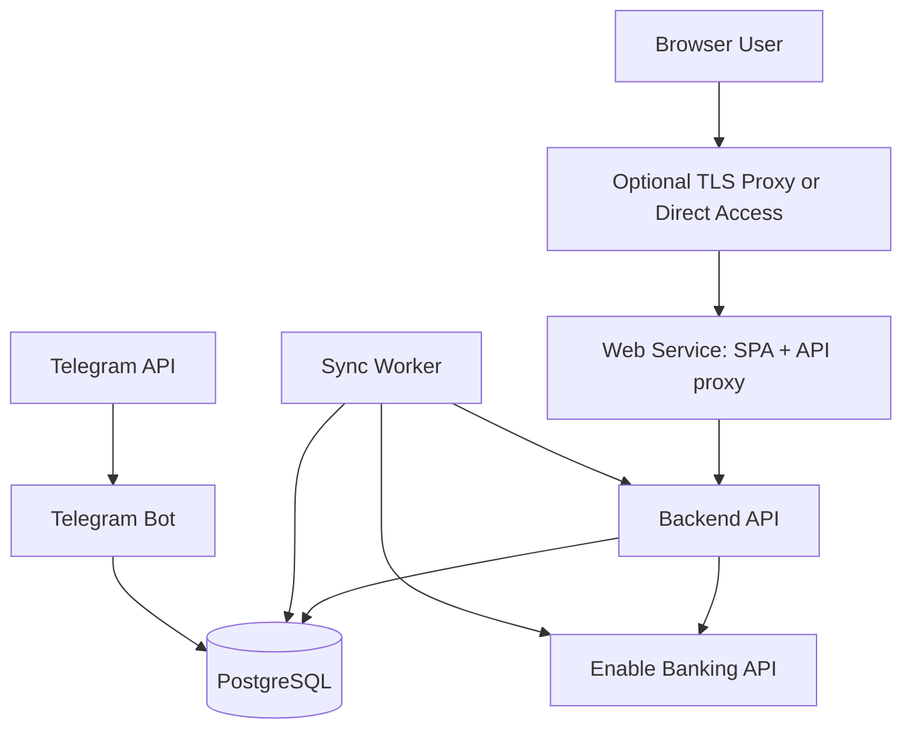

# BurnRate Deployment Model

## Goal

This document defines the intended deployment model for BurnRate.

For the first version, BurnRate should be deployed as a small self-hosted system using Docker Compose.

This matches the product goals well:

* Single-owner oriented
* Self-hosted by default
* Low operational complexity
* Suitable for a home server, mini PC, NAS, or small VPS

---

## Deployment Strategy

BurnRate should use Docker Compose as the default deployment model.

This should be true for:

* Local development
* Personal self-hosted production
* Small VPS deployment

The project should not assume Kubernetes, cloud-managed services, or multi-node orchestration in the first version.

---

## Why Docker Compose Fits BurnRate

Docker Compose is a good fit because BurnRate:

* Has a small number of runtime components
* Needs predictable service-to-service networking
* Benefits from simple environment-variable based configuration
* Needs a durable PostgreSQL volume
* Is intended to be deployable by one technical owner without heavy infrastructure work

The deployment model should remain boring and dependable.

---

## Runtime Services

The expected first runtime layout is:

* `postgres`
* `backend`
* `web`
* `sync-worker`
* `telegram-bot`

Optional later services:

* `reverse-proxy`

---

## Service Responsibilities

### `postgres`

Responsibilities:

* Store application and integration data
* Persist BurnRate state durably
* Provide one database instance for backend and worker access

Notes:

* PostgreSQL should use a named volume
* Backups should be considered part of operational hardening later
* **The session `TimeZone` must stay UTC**, which is PostgreSQL's default. Do not set `TZ` or `PGTZ` on this container. A transaction the bank dated neither way falls back to `date(imported_at)` for its month placement, and `date(timestamptz)` converts through the session timezone — so the same instant is 30 June under `UTC` and 1 July under `Europe/Madrid`, and undated charges would move between months silently. The test suite cannot catch this: SQLite has no timezone database and its `date()` reads the stored naive UTC wall clock, so the expression the tests exercise would not be the one that ships. See `docs/technical/domain.md` on Effective Date, and the docstring in `burnrate/db/effective_date.py`

---

### `backend`

Responsibilities:

* Expose the HTTP API
* Handle Enable Banking callback requests
* Serve application use cases to the Web UI
* Coordinate reads and writes to PostgreSQL

Notes:

* This service hosts the main application runtime
* It should not depend on Telegram being present
* It binds loopback and is reached only through `web`'s nginx, including for the Enable Banking callback. It runs with `--forwarded-allow-ips "*"`, which is safe *only* because that nginx overwrites `X-Forwarded-For`; see the Networking Model below and `docs/adr/0004-the-web-origin-is-the-only-origin.md`

---

### `web`

Responsibilities:

* Provide the primary user interface
* Consume backend APIs
* Guide the owner through bank linking, transaction review, budgeting, and summary views
* Serve the SPA *and* proxy the backend under the same origin

Notes:

* This is a separate frontend container, and it is the only service published
* Its nginx proxies `/api/v1/` and `/enable_banking_items/` to `backend`, so the browser only ever talks to the origin it loaded the page from. This is not optional decoration: it is what keeps requests off the cross-origin path, and the Enable Banking callback reaches the handler only because the second location is proxied. See `docs/adr/0004-the-web-origin-is-the-only-origin.md`
* `web/nginx.conf` is `COPY`ed into the image at build time, so a change to it needs an image rebuild, not a container restart
* The config uses a variable `proxy_pass` with Docker's embedded resolver, so it requires a runtime that provides `127.0.0.11`. On anything other than Compose, every proxied request fails
* An external TLS-terminating proxy in front of this one is still reasonable, and would route to `web` alone — see `reverse-proxy` below

---

### `sync-worker`

Responsibilities:

* Run scheduled synchronization jobs
* Refresh balances and transactions from Enable Banking
* Record sync session status

Notes:

* This is a separate runtime component, not a separate business layer
* It should reuse the same application and domain code as the backend

---

### `telegram-bot`

Responsibilities:

* Run the Telegram bot as a long-polling worker (`python -m burnrate.telegram_bot`)
* Expose backend-derived summaries, budget status, and the unknown queue through chat
* Restrict access to an allow-list of chat ids (`TELEGRAM_ALLOWED_CHAT_IDS`)

Notes:

* This is a separate runtime component that reuses the same application services as the backend
* It is read-only and secondary to the Web UI; it implements no financial logic of its own
* If `TELEGRAM_BOT_TOKEN` is empty the process logs and exits, so the bot can be left disabled

---

### `reverse-proxy` (Optional)

Responsibilities:

* Terminate HTTPS
* Route traffic to `web`
* Optionally handle public exposure and hostnames

Notes:

* `Caddy` or `Nginx` would both be reasonable options
* This may be omitted in local development
* It routes to `web` only. `backend` is reached through `web`'s own nginx, and publishing it separately would reopen the cross-origin arrangement ADR-0004 closed
* If one is added, its forwarded client address has to be trusted in `web/nginx.conf` explicitly. That file overwrites `X-Forwarded-For` rather than appending to it, so an upstream proxy's value is discarded by design

---

## Suggested Compose Topology

The logical service topology should look like this:

This reflects the intended runtime structure without requiring complex orchestration.

---

## Networking Model

The Compose setup should use one internal application network by default.

Recommended behavior:

* `postgres` should not be publicly exposed by default
* `backend` binds loopback and must not be published on any interface
* `web` publishes a host port, and is the only service that does
* `sync-worker` should not expose any public port

If an external reverse proxy is used, it should be the only service directly exposed publicly.

Two of these are load-bearing for more than tidiness, and they cover different
attacks. `backend`'s loopback bind is what stops the proxy being bypassed.
`web/nginx.conf` overwriting `X-Forwarded-For` from `$remote_addr` is what stops
it being spoofed *through* the proxy: uvicorn runs with
`--forwarded-allow-ips "*"` and trusts the leftmost entry, so with the appending
form a request supplied its own client address — and the login lockout and the
Enable Banking rate limiter both key on it, which made unlimited password guesses
and unlimited bank syncs available to anyone who could reach the published port.
Publishing `backend` to get at the API directly removes the first guard and
leaves the second doing nothing, because the request never passes through nginx.

---

## Persistence Model

The first deployment should persist:

* PostgreSQL data

Optional later persistence:

* Application logs
* Backup exports

Recommended approach:

* Use a named Docker volume for PostgreSQL
* Keep application containers stateless where possible

---

## Configuration Model

BurnRate should be configured primarily through environment variables.

Expected configuration areas:

* PostgreSQL connection settings
* Enable Banking application ID
* Enable Banking private key or path to mounted key
* Enable Banking redirect URL
* Application base URLs
* Sync schedule configuration
* Telegram bot token, if Telegram is enabled

The project should support a local `.env` file for development and simple self-hosted deployment.

---

## Secrets Handling

For the first version:

* Secrets may be provided through environment variables or mounted files
* The Enable Banking private key should never be baked into an image
* Database passwords should not be hard-coded in Compose files committed to the repository

For personal self-hosting, simple secret handling is acceptable as long as secrets remain outside version control.

---

## Environments

The project should assume at least three practical environments:

### Local Development

Characteristics:

* Docker Compose
* Local `.env`
* Host port exposure for backend and web
* Fast iteration and debugging

### Personal Production

Characteristics:

* Docker Compose
* Persistent PostgreSQL volume
* Restricted production Enable Banking configuration
* Optional reverse proxy and HTTPS

### CI or Test Environment

Characteristics:

* Ephemeral PostgreSQL
* Short-lived backend and worker containers
* Test-focused configuration

---

## Operational Expectations

The first deployment model should support:

* Starting all services with one Compose command
* Running migrations before or during startup
* Restarting services independently
* Inspecting logs per service
* Rebuilding a single service without tearing down the whole stack

This is one of the strongest practical reasons to prefer Docker Compose for BurnRate.

---

## Observability

BurnRate uses simple, structured stdout logging so `docker compose logs` is the primary diagnostic tool.

* The `backend`, `sync-worker`, and `telegram-bot` configure logging on startup at the level set by `LOG_LEVEL` (default `INFO`), using a shared format.
* Each HTTP request is logged with method, path, status code, and duration.
* Unexpected server errors are logged with a full traceback and returned to clients as a consistent `{"detail": "Internal server error"}` 500 response — stack traces are never exposed to the client.
* Deliberate `HTTPException` responses keep their own status and detail and are not converted into 500s.

For deeper diagnosis, log level can be raised to `DEBUG` through `LOG_LEVEL` without code changes.

## What Not To Optimize For Yet

The first version should not optimize for:

* Horizontal scaling
* Multi-node orchestration
* Cloud-vendor portability
* Multi-tenant isolation
* High-availability clusters

If BurnRate grows into something bigger later, the runtime model can evolve.

For now, simplicity is a feature.

---

## Recommended Future Files

When implementation begins, the repository will likely need:

* `docker-compose.yml`
* `docker-compose.override.yml` for local development, if needed
* `.env.example`
* Container definitions for `backend`, `web`, `sync-worker`, and `telegram-bot`

Optional later files:

* Reverse proxy config
* Backup scripts
* Restore scripts

---

## Definition of Done for Deployment

The first deployment milestone should be considered complete when:

* A new machine can start BurnRate with Docker Compose
* PostgreSQL persists data across container restarts
* The backend can reach Enable Banking and PostgreSQL
* The Web UI can reach the backend
* The sync worker can run independently from the API process
* The owner can perform the full restricted-production bank linking and sync flow on that deployment
