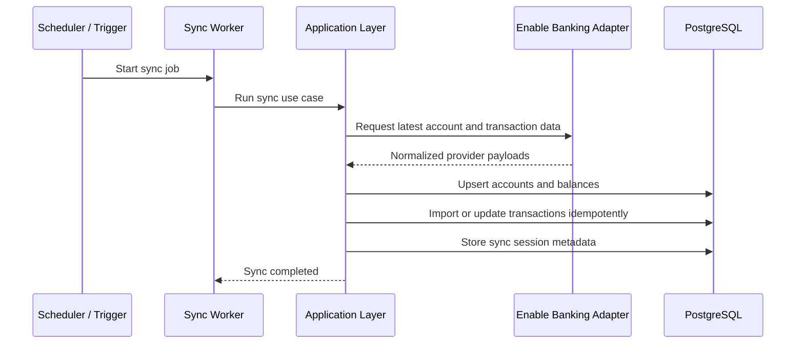
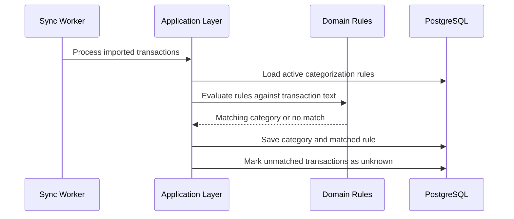
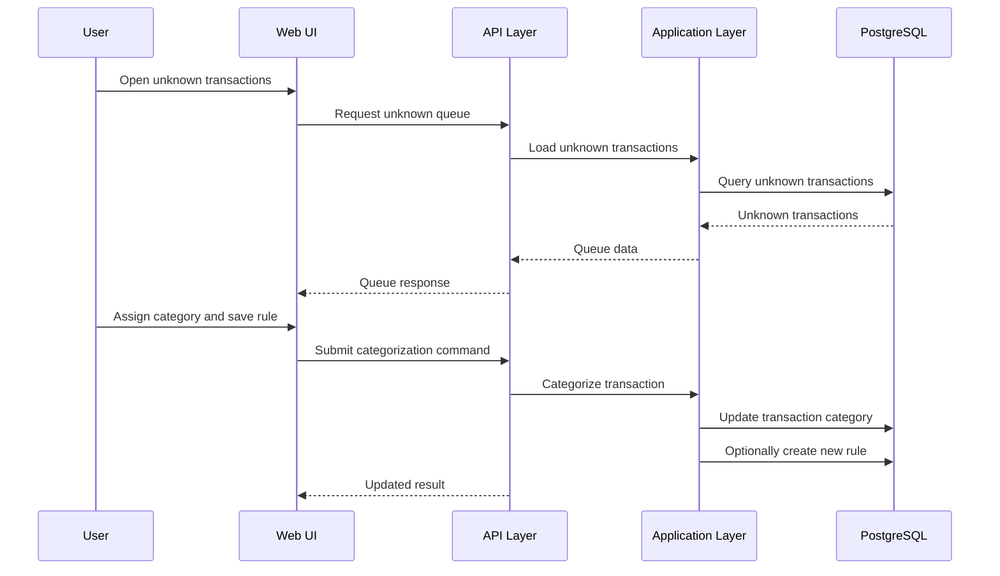
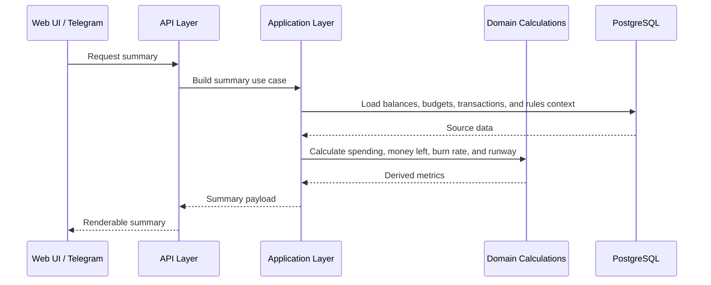
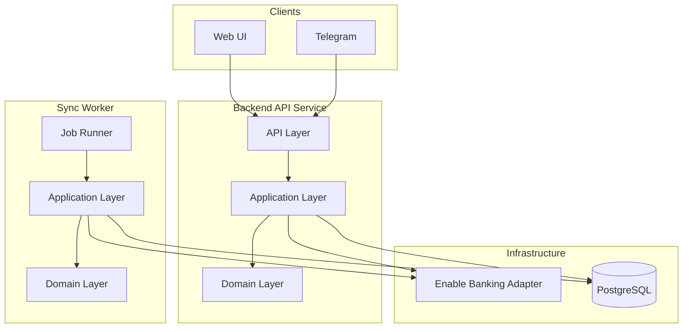

# BurnRate Technical Flows

## Goal

This document describes the main runtime flows of BurnRate in a diagram-oriented format.

The goal is to make the architecture easier to reason about by showing how the main components collaborate during common operations.

---

## Flow 1: Bank Synchronization

This flow shows how BurnRate imports accounts, balances, and transactions from Enable Banking.

Key points:

* The worker runs the sync, but the business flow lives in the application layer.
* Enable Banking remains behind an adapter boundary.
* Imports must be idempotent so repeated syncs do not duplicate transactions.

---

## Flow 2: Automatic Categorization

This flow shows how imported transactions are categorized using stored rules.

Key points:

* Rules should match only transaction naming fields such as description or merchant text.
* Matching behavior belongs to application and domain logic, not to the bank integration.
* Unknown transactions remain visible for later user review.

---

## Flow 3: Manual Categorization From Web UI

This flow shows how a user reviews an unknown transaction and optionally creates a reusable rule.

Key points:

* The Web UI stays thin and relies on backend APIs.
* Manual categorization can improve future automation by generating a rule.
* The unknown queue is a normal product workflow, not an error state.

---

## Flow 4: Summary Generation

This flow shows how BurnRate assembles the main budget and runway summary for a client.

Key points:

* Clients should never calculate financial metrics themselves.
* The backend owns the definitions of spending, money left, burn rate, and runway.
* Web UI and Telegram should consume the same summary capabilities.

---

## Flow 5: Layer and Runtime Relationship

This diagram shows the difference between logical layers and deployed components.

Key points:

* `Presentation`, `API`, `Application`, and `Domain` are logical layers.
* `Backend API Service` and `Sync Worker` are runtime components that reuse those layers.
* The bank adapter and PostgreSQL live in infrastructure.
